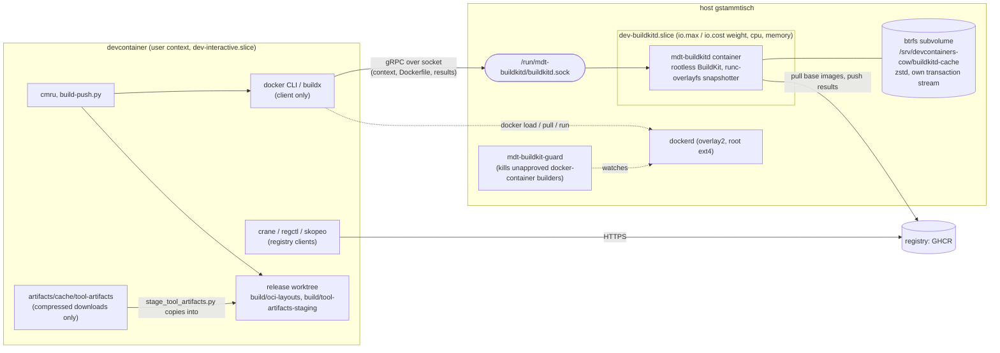
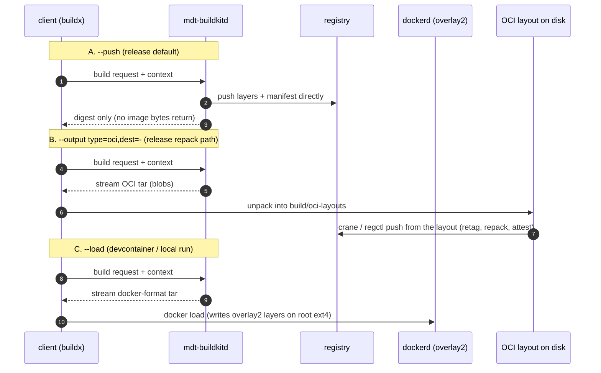

# mdt-buildkitd: components, data flows and trade-offs

Supplement to [BUILD-ARCHITECTURE.md](BUILD-ARCHITECTURE.md) (policy and limits) and
[OCI-IMAGE-TOOLING.md](OCI-IMAGE-TOOLING.md) (the registry tools). This file answers three
questions: which process touches which bytes, on which filesystem, charged to which cgroup; how the
image operations (`--push`, `--output type=oci`, `--load`, `crane`, `regctl`, `skopeo`) differ; and
what the managed setup costs as well as what it buys.

## 1. Components and where they live

| Component | Runs as / where | Owns |
|---|---|---|
| `docker` / `buildx` | devcontainer, user | nothing; sends requests, receives results |
| `mdt-buildkitd` | host systemd unit, `docker run` in `dev-buildkitd.slice`, rootless uid 1000 | the BuildKit content store, snapshots, build cache (on btrfs via `DEV_BUILDKITD_CACHE`) |
| `dockerd` | host | the *Docker* image store (overlay2 on the root ext4), running containers |
| `crane`, `regctl`, `skopeo` | devcontainer or tester, user | no state; talk to registries or OCI layouts on disk |
| `mdt-buildkit-guard` | host | terminates any unapproved `docker-container` Buildx worker so nobody builds outside the slice |
| artifact cache | devcontainer project dir, gitignored | `tool-artifacts/by-url/<sha256>/{payload,metadata.json}` |

Two stores, deliberately separate: BuildKit's store is for **building**, the Docker store is for
**running**. The remote Buildx driver cannot see the Docker store (that is why a `FROM local-tag`
fails on the managed builder, and why the devcontainer templates declare no `features`).

## 2. What happens on a build, step by step

1. The client (`docker buildx build`) connects to the socket and streams the **build context** (only
   changed files after the first run) plus the Dockerfile.
2. `buildkitd` resolves `FROM` images itself: it pulls them from the registry into its **own**
   content store (not through dockerd, so a base image pulled by `docker pull` is not reused).
3. Each `RUN` executes in a runc sandbox on an overlayfs snapshot. Files written by the step (apt
   packages, unpacked tool archives) land in the snapshot on the btrfs subvolume and are
   compressed there transparently.
4. `buildkitd` keeps the resulting layers as cache. The **cache is not a registry-visible
   artifact**; it only speeds up the next build on this worker.
5. The result is delivered according to the exporter (section 3).

Tool archives: `artifacts/cache/tool-artifacts` only ever holds the **downloaded, compressed**
archives (`.tar.gz`, `.zip`; about 6 GB for 160 entries). `stage_tool_artifacts.py` copies the ones
a build needs into `build/tool-artifacts-staging/downloads`, and the Dockerfile bind-mounts that
directory into the `RUN` that extracts them (`tar -xzf ...`, `unzip ...`). Extraction therefore
happens **inside BuildKit's snapshot**, never in the artifact cache. The extracted binaries exist
only in the image layers and in BuildKit's cache.

## 3. The delivery paths

| Path | Image bytes travel | Lands in | Use it for | Cost |
|---|---|---|---|---|
| `--push` | buildkitd → registry only | registry | releases without local post-processing | least IO; needs registry write credentials in the build session |
| `--output type=oci` | buildkitd → client → layout dir | `build/oci-layouts` (worktree) | repack/retag/inspect before push; push with a tool that can address the layout | writes the whole image once on the client side; tool compatibility (crane vs regctl) matters |
| `--load` | buildkitd → client → dockerd | Docker overlay2 store (root ext4) | running the image locally, devcontainer start | writes the image a second time on the root filesystem; the layer tar is rebuilt |
| plain `docker build` (classic) | not used: forced onto the managed builder via `BUILDX_BUILDER` | | | |

Registry tools, by job:

| Tool | Reads/writes | Typical job here |
|---|---|---|
| `crane` | registry or tarball; `crane push <layout-dir>` needs an unambiguous layout | digest, manifest, copy, simple push; auto-falls back to plain HTTP for localhost registries |
| `regctl` | registry **and** `ocidir://` layouts; can export `image export | docker load` | layout-scoped push by tag, referrers/attestations, deep inspection |
| `skopeo` | registry, `oci:` dirs, `docker-daemon:` | copy between transports, signature work |
| `docker load` | tar into the Docker store | the only way into dockerd (it cannot ingest an OCI layout directly on this daemon) |

## 4. The use cases

| Use case | Command shape | Path | Touches |
|---|---|---|---|
| Release an image | `cmru release` → `build-push.py` → `--push` | A | buildkitd, registry; nothing in dockerd |
| Release with repack | `--output type=oci` → regctl/crane push | B | buildkitd, worktree layout, registry |
| Devcontainer build/rebuild | devcontainer CLI → `buildx build --load` | C | buildkitd then dockerd; **no features** (a `FROM` local tag cannot be built remotely) |
| Pull to run | `docker pull` | none | registry → dockerd only; buildkitd uninvolved |
| Inspect a published image | `crane manifest`, `regctl manifest get` | none | registry only |
| Test an OCI push | `run_oci_push_lane.py` | B plus local registry | remote-driver node on `BUILDKIT_HOST` |
| Cold start of a fresh host | first build | A/B/C | pulls every base image into buildkitd's store; the whole build cache is rebuilt |

## 5. Why this setup (advantages)

- **One governed place for build IO and CPU.** Everything BuildKit does is in `dev-buildkitd.slice`,
  so `io.cost` / `io.max` and CPU/memory limits apply to builds as a unit and a build cannot starve
  the production workload on the shared host. Verified: btrfs data IO of a build is attributed to
  the slice (`io.stat`).
- **No build processes outside the slice.** The guard removes unapproved docker-container workers,
  so a stray `buildx create` cannot bypass the limits.
- **Cache on compressed btrfs.** 22 GB logical data occupy 13 GB; no ext4 root growth; a separate
  filesystem with its own transaction stream, so build bursts do not share journal commits with the
  root filesystem the game server uses.
- **Rootless.** The daemon runs Dockerfile `RUN` content as uid 1000 inside a user namespace; the
  host's root is not exposed to build steps.
- **Same endpoint everywhere.** `BUILDX_BUILDER` / `BUILDKIT_HOST` are estate settings in
  `cmru.orchestration.toml`; a system without mdt-buildkitd overrides them once.
- **Pushes bypass the devcontainer.** `--push` sends layers from the daemon to the registry, so the
  devcontainer's network and disk are not in the data path.

## 6. Disadvantages and what to do about them

| Disadvantage | Effect | Mitigation |
|---|---|---|
| Two image stores (BuildKit + Docker) | an image is stored twice after `--load`; base images pulled twice | `--push`/`type=oci` for releases; periodic `docker builder prune`-equivalent on buildkitd (`gckeepstorage`, MDT-024) |
| Remote builder cannot see the Docker store | `FROM local-tag`, devcontainer features, and `tester-base:local` style builds fail | use registry tags or `--build-context name=oci-layout://...`; no `features` in templates |
| `--load` streams a tar through the client | slow for multi-GB images, writes twice | avoid for releases; only for local run |
| Single shared daemon | parallel builds queue behind `max-parallelism`; one wedged build affects all | `DEV_BUILDKITD_MAX_PARALLELISM`; restart is cheap, cache survives |
| btrfs is not the default | rootless overlayfs on btrfs works but is less commonly exercised than ext4/xfs; compression costs CPU | zstd level 3 default; benchmark showed no slowdown (MDT-024) |
| No-process-sandbox flag | a `RUN` step can signal other processes in the same worker | acceptable for a single-tenant dev builder |
| Cache size grows without bound | the 194 GB pool is shared with the VM harness | set `gckeepstorage` (MDT-024 follow-up); keep an eye on `compsize` |
| Host-managed | a change needs `install.sh` + `systemctl restart mdt-buildkitd` on the host | documented; the unit stamp reports a pending restart |

## 7. Optional: skipping fsync for cache operations (eatmydata)

The risk is only crash safety: after a power loss the cache may be corrupt and is rebuilt. That is
acceptable for a *cache*, but `libeatmydata` (an `LD_PRELOAD` shim) works only for **dynamically
linked** programs, and the two places that matter differ:

- **`buildkitd` itself** (content store, bolt metadata, snapshot commits) is a **static Go
  binary** that issues raw syscalls, so `LD_PRELOAD` has no effect. The honest options are a
  seccomp filter that turns `fsync`/`fdatasync`/`sync_file_range`/`syncfs` into no-ops (it also
  applies to every nested `RUN`; requires a custom full profile because the unit is currently
  `seccomp=unconfined`), or a different storage setting. Neither is implemented or measured.
- **Processes inside `RUN` steps** (dpkg, apt, tar, pip) are dynamic and are where most fsync
  traffic comes from. Two supported ways: `dpkg --force-unsafe-io` (a dpkg option, no extra package;
  `echo force-unsafe-io > /etc/dpkg/dpkg.cfg.d/unsafe-io` inside the build stage, removed before the
  final stage so the shipped image keeps default behaviour) or `eatmydata apt-get install ...` with
  the `eatmydata` package in the builder stage. Both apply per Dockerfile, not per host.

Recommendation: add the `RUN`-level variant as a build ARG (`MDT_BUILD_UNSAFE_IO=1`, default off)
only after measuring; the cold btrfs build already ran at about 30 MB/s average write, so the gain
is likely modest and the cost is a Dockerfile change plus a release. Tracked as MDT-026.
