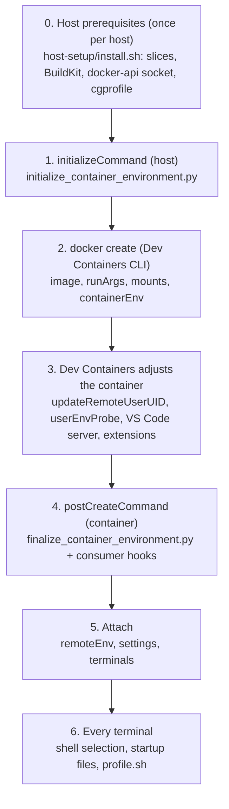
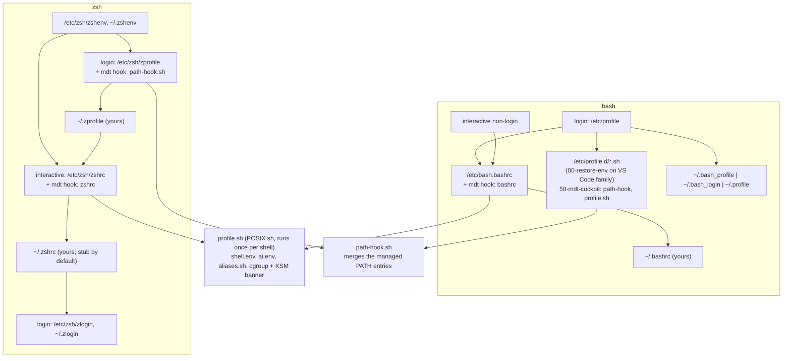

# How an mdt devcontainer works, end to end

This is the map. It follows one devcontainer from the host prerequisites to a terminal prompt
and names every mechanism on the way: what it does, where it is defined, when it runs and who
owns it. Each section links to the document that holds the detail; the detail is not repeated
here. If you only want to change something, use the [task index](#task-index) at the end.

Terms: **host** is the Docker host; **image** is `mdt-cockpit-devcontainer` (the VS Code family)
or `mdt-cockpit` (the native family); **consumer** is the repo or folder that owns the
`devcontainer.json`. The two template layouts (per-repo and host-side folder) differ only in the
keys listed in [templates/host-folder/README.md](../templates/host-folder/README.md).

## 1. Timeline



| Phase | Runs on | Defined in | Failure behaviour |
|---|---|---|---|
| 0 Host setup | host, as root, by hand | `host-setup/` | Later phases refuse to start (see 1) |
| 1 `initializeCommand` | host, as you, before the container exists | `.devcontainer/initialize_container_environment.py` (vendored) | Non-zero exit stops creation |
| 2 create | Docker | `devcontainer.json` | `--mount` with a missing source stops creation |
| 3 adjust | Dev Containers | `devcontainer.json` (`remoteUser`, `userEnvProbe`, `customizations`) | Extension failures are non-fatal |
| 4 `postCreateCommand` | container, once per create | `finalize_container_environment.py` (baked into the image) | mdt steps warn; a failing consumer hook fails the step |
| 5 attach | container | `remoteEnv`, VS Code settings | n/a |
| 6 terminal | container | `/etc`, `/usr/local/share/mdt-cockpit`, your home | A broken rc file affects only that shell |

Why two scripts live in two places: `initializeCommand` runs before the container exists, so its
script cannot come from the image and is vendored into your repo; `postCreateCommand` runs inside
it, so its script is baked in and referenced by name. Background:
[DEVCONTAINER-LIFECYCLE.md](../DEVCONTAINER-LIFECYCLE.md).

## 2. Host prerequisites (phase 0)

The container is placed into, and talks to, host-owned resources. `host-setup/install.sh --wizard`
creates them and `mdt-host-check.sh` verifies them. Nothing in the container can create them.

| Resource | Purpose | Consumed through |
|---|---|---|
| `dev-interactive.slice`, `dev-background.slice`, `dev-gates.slice` (under `dev.slice`) | CPU, memory, IO tiers for this container, long-running stacks and gate containers | `--cgroup-parent` runArg; `CGROUP_PARENT_DEV_*` env |
| `/run/docker-api` | directory-level bind of the Docker socket; survives `dockerd` restarts | mount + `DOCKER_HOST` |
| `/run/mdt-buildkitd` | socket of the host-managed BuildKit (`mdt-managed` remote builder) | mount + `BUILDX_BUILDER`, `BUILDKIT_HOST` |
| `/run/cgprofile` | cgroup-profiler control socket (optional; `run-gate` falls back to `docker exec`) | mount |
| `/sys/kernel/debug` (read-only) | debugfs statistics such as zswap | mount |
| `DOCKER_GID` | host `docker` group, so the container can use the socket | `--group-add ${localEnv:DOCKER_GID}`; export it in the host shell before launching |
| `/etc/mdt/host-setup.env` | host policy, including `DEVCONTAINER_MISSING_BIND_SOURCE_POLICY` | read by phase 1 |
| Optional btrfs area `/srv/devcontainers-cow/<user>` | snapshots, reflinks | commented-out mount + `MDT_COW_ROOT` ([BTRFS-COW.md](BTRFS-COW.md)) |

Governance detail: [host-setup/README.md](../host-setup/README.md),
[CONSUMERS.md, host prerequisite](CONSUMERS.md#host-prerequisite).

## 3. `initializeCommand`: host bootstrap (phase 1)

`python3 .devcontainer/initialize_container_environment.py`, run on the host in the opened
folder. Standard library only; idempotent. It does two jobs:

1. **Cgroup preflight.** It checks that the three slices named in `containerEnv` are loaded from
   installed unit files (exact ID, `LoadState=loaded`, a real `FragmentPath`) and that the
   `--cgroup-parent` runArg matches the interactive slice. Docker would otherwise create a
   transient, unlimited slice for an unknown parent and the container would start ungoverned.
   Design: [DESIGN-GUIDE.md](DESIGN-GUIDE.md#host-cgroup-preflight).
2. **Bind-source preparation.** For every `type=bind` source under `$HOME` it inspects the real
   filesystem type. A missing source is created under the policy
   `DEVCONTAINER_MISSING_BIND_SOURCE_POLICY`:
   - `create-by-spelling` (default): a trailing `/` makes a directory, no trailing `/` makes an
     empty file (`0600`). Keep the slash on every directory source.
   - `fail`: the source must already exist.

   Modes follow the mount **target**, not the source name: the source mounted at the container
   home gets `0700`, the source mounted at `/tmp` gets `1777`, other directories `0755`. Source
   names are therefore free (for example one pair per project). Design:
   [DESIGN-GUIDE.md](DESIGN-GUIDE.md#bootstrap-uses-the-source-filesystem-type).

   The initializer expands `${localEnv:HOME}` and `${localWorkspaceFolderBasename}` itself,
   because it creates paths before the Dev Containers CLI has substituted anything. A variable it
   does not know stays literal and **would be created as a directory with that literal name**;
   see [Troubleshooting](#troubleshooting).

It also prints one informational line if the previous layout's `~/mdt--mounted-folders/` still
holds files while the new home is empty. It never migrates anything.

## 4. Create time: image, runArgs, mounts, environment (phase 2)

Everything here is fixed when the container is created. Changing it needs a rebuild.

### Image and user

`image` selects `mdt-cockpit-devcontainer:<tag>`. `remoteUser: vscode` is created by the image
(uid/gid 1000, login shell `/bin/bash`). No devcontainer **features** are used: a feature makes the
CLI build a local `vsc-*-features` image, and the follow-up `updateRemoteUserUID` build then fails
because the managed remote builder cannot see the local image store.

### runArgs

| Argument | Why |
|---|---|
| `--name`, `--hostname` | stable identity (`<repo>-devcontainer-<user>`, or `mdt-cockpit-<user>` in the host-folder variant) |
| `--group-add ${localEnv:DOCKER_GID}` | access to the Docker and BuildKit sockets |
| `--cgroup-parent=dev-interactive.slice` | host resource tier; placement is create-time only |
| `--cap-add SYS_ADMIN`, `--device /dev/fuse` | sshfs and `mount(2)` inside the container |
| `--security-opt apparmor=unconfined`, `seccomp=unconfined` | same, plus nested tooling |

`--cgroup-parent` and the preflight in phase 1 must stay together; removing the initializer while
keeping the runArg silently loses governance.

### Mounts

| Source (host) | Target | Notes |
|---|---|---|
| `/run/docker-api`, `/run/mdt-buildkitd`, `/run/cgprofile` | same path | Host integration. `--mount` semantics: a missing source stops creation, which is deliberate. |
| `/sys/kernel/debug` | same path, read-only | Observation only. |
| `~/.ssh/` | `/run/mdt/host-ssh`, read-only | Host keys, kept outside the persistent home. |
| `~/mdt-cockpit-…-home/` | `/home/vscode` | The complete persistent home, `0700`. |
| `~/mdt-cockpit-…-tmp/` | `/tmp` | Host-backed scratch, `1777`; visible to sibling containers that bind the same directory, so `/tmp` worktrees can be gated. |
| `<config folder>/.devcontainer` | `/run/mdt/devcontainer`, read-only | Host-folder variant only: where `finalize` finds the consumer hooks. |
| optional extras | | Git config, CoW area, sibling repos: [CONSUMERS.md](CONSUMERS.md#optional-git-config-mount). |

### Environment

- **Image `ENV`** (Dockerfile): `PATH` (one definition), `NPM_CONFIG_PREFIX=/opt/mdt/npm`,
  `UV_PYTHON_INSTALL_DIR=/opt/mdt/python`, `LD_PRELOAD` for the KSM shim, `MDT_PATH_PREFIX/SUFFIX`.
- **`containerEnv`** (template): host facts only: `DOCKER_HOST`, `BUILDX_BUILDER`, `BUILDKIT_HOST`,
  `BUILDX_CONFIG`, `CGROUP_PARENT_DEV_{INTERACTIVE,BACKGROUND,GATES}`, `CODEX_SQLITE_HOME`.
  Seen by every process in the container, including `docker exec`.
- **`remoteEnv`** (template): `PWMCP_MCP_URL`. Applied to processes the Dev Containers server
  starts (terminals, tasks), not to `docker exec`.
- The template deliberately sets no `PATH`. A consumer adds an entry with
  `containerEnv.PATH` ([CONSUMERS.md](CONSUMERS.md#adding-a-path-entry)).

Complete variable table: [DESIGN-GUIDE.md](DESIGN-GUIDE.md#environment-variables).

## 5. Dev Containers adjustments (phase 3)

These are performed by the Dev Containers extension or CLI, not by mdt, but they shape what you
see:

- **`updateRemoteUserUID`** renumbers `vscode` to your host uid (for example 1003) and re-owns
  **only** `$HOME`. This is why image-owned trees under `/opt/mdt` and `/srv` are owned by the
  group `mdt` (GID 2750, setgid directories, group-writable files) rather than by a user:
  group membership survives the renumbering. See [the `mdt` group](DESIGN-GUIDE.md#the-mdt-group).
- **VS Code server and extensions** are installed under `~/.vscode-server`, which lives in the
  persistent home.
- **`userEnvProbe`** (default `loginInteractiveShell`) starts your shell once to capture its
  environment for the server. It runs the login **and** interactive startup files, so a slow or
  noisy rc file affects every VS Code start.
- **`customizations.vscode.settings` and `extensions`** come from the `devcontainer.json`.
  The template sets `python.defaultInterpreterPath` only; it sets no terminal profile (see
  [Shell selection](#shell-selection)).
- **`shutdownAction: "none"`** keeps the container running when the VS Code window closes.

## 6. `postCreateCommand`: finalizer (phase 4)

`finalize_container_environment.py`, baked into the image at `/usr/local/bin`, runs once when the
container is created, after the home mount is active. Order:

1. `finalize.pre.d/*.sh` (consumer hooks, sorted; `finalize.pre.sh` after the directory)
2. Generic mdt steps, all best effort (a failure warns, never fails the build):
   - `~/.zshrc` stub: a comment-only file, written only if none of `.zshenv`, `.zprofile`,
     `.zshrc`, `.zlogin` exists, never edited later. It exists solely to stop zsh's new-user
     wizard, which cannot be disabled system-wide. This is the only file mdt writes into the home.
   - `<workspace>/.vscode/settings.json`: `python.defaultInterpreterPath` and
     `python.terminal.activateEnvironment=false`, only if the file does not exist.
   - Docker socket relay repair (only where a `docker-outside-of-docker` relay is present).
   - Managed BuildKit builder: validate and reuse `mdt-managed`; a partial or different
     `BUILDX_BUILDER`/`BUILDKIT_HOST` pair fails finalization.
   - Tool check: `bat fd rg fzf yq jq git docker python3` on `PATH`.
3. `finalize.post.d/*.sh` (consumer hooks, sorted; `finalize.post.sh` after the directory)

Consumer hooks are where project setup (for example `ciu env generate`) belongs. They receive
`MDT_FINALIZE`, `MDT_ENV_TYPE`, `MDT_WORKSPACE_DIR`, `MDT_DEVCONTAINER_DIR`,
`MDT_USER/UID/GID/DOCKER_GID`. A hook that exits non-zero makes finalize exit non-zero; by default
the remaining hooks still run, `MDT_FINALIZE_STRICT=1` stops at the first failure. Flags:
`--no-hooks`, `--hooks-only`, `--devcontainer-dir PATH`. mdt never imports ciu. Full contract:
[DEVCONTAINER-LIFECYCLE.md](../DEVCONTAINER-LIFECYCLE.md#consumer-hook-contract).

## 7. The filesystem split

| Area | Owner | Persists | Holds |
|---|---|---|---|
| `/home/vscode` | you (host bind, `0700`) | across rebuilds | credentials, agent state, `.config`, `.local`, caches, history, worktrees |
| `/tmp` | you (host bind, `1777`) | across rebuilds | scratch, `/tmp` worktrees |
| `/opt/mdt/*`, `/srv/pwmcp-instance` | group `mdt` | no: recreating the container restores the image | venvs, npm CLIs, uv Pythons, Oh My Zsh, PWMCP |
| `/etc/*`, `/usr/local/share/mdt-cockpit` | image | no | system-wide defaults, shipped shell files, examples, manifest |
| `/run/mdt/host-ssh` | host | read-only | host SSH keys |

The image's own home is empty. Nothing is copied into your home, so an image update always
reaches you, and you override a default by creating your own file. Path inventory:
[HOME-PERSISTENCE.md](HOME-PERSISTENCE.md); rationale:
[DESIGN-GUIDE.md](DESIGN-GUIDE.md#the-home-is-user-state-image-assets-live-outside-it);
per-tool system locations: [DESIGN-GUIDE.md](DESIGN-GUIDE.md#system-wide-defaults).
Updating an image tool in place (`npm install -g`, `pip install` into `/opt/mdt/venv`) works
without `sudo` and lasts until the container is recreated.

## 8. Shell selection and startup

### Shell selection

VS Code picks the terminal shell in this order:

1. `terminal.integrated.defaultProfile.linux`, if set in any settings layer (workspace
   `.vscode/settings.json`, the devcontainer's `customizations.vscode.settings`, user or
   remote-machine settings).
2. Otherwise the login shell in `/etc/passwd`. The image creates `vscode` with `/bin/bash`.

The templates set no terminal profile, so a terminal opens **bash**. To get zsh in VS Code, add:

```jsonc
"customizations": { "vscode": { "settings": {
  "terminal.integrated.defaultProfile.linux": "zsh"
} } }
```

This changes the VS Code terminal only. `docker exec`, `ssh`, tasks and `$SHELL` still use bash. To
change them as well, change the login shell (`chsh -s /usr/bin/zsh vscode`, or in the image).
Both shells are installed in both image families.

### Files processed

The image installs its defaults as **hooks appended to the system files**, not as files in your
home. Your own files run after them and win.

| Shell and mode | Order |
|---|---|
| bash, interactive non-login (a VS Code terminal) | `/etc/bash.bashrc` (ends with the mdt hook → `bashrc` → `profile.sh`), then `~/.bashrc` |
| bash, login (`bash -l`, `userEnvProbe`) | `/etc/profile` (patched to keep an inherited `PATH`) → `/etc/bash.bashrc` when interactive → `/etc/profile.d/*.sh` (on the VS Code family `00-restore-env.sh` first; then `50-mdt-cockpit.sh`: path hook, then `profile.sh`) → first of `~/.bash_profile`, `~/.bash_login`, `~/.profile` |
| zsh, every invocation | `/etc/zsh/zshenv`, `~/.zshenv` |
| zsh, login (extra) | `/etc/zsh/zprofile` (ends with the mdt hook → `path-hook.sh`), `~/.zprofile`; after `zshrc`: `/etc/zsh/zlogin`, `~/.zlogin` |
| zsh, interactive | `/etc/zsh/zshrc` (ends with the mdt hook → `zshrc` → `profile.sh`, Oh My Zsh, fzf, autosuggestions, syntax highlighting), then `~/.zshrc` |
| any non-interactive shell, scripts, `docker exec cmd` | no rc file at all; environment comes from image `ENV` and `containerEnv` |

Two properties to remember. zsh **does not read `/etc/profile` or `/etc/profile.d/*`** on Debian,
which is why the `PATH` hook is attached to `/etc/zsh/zprofile` as well. And nothing creates
`~/.bashrc`, `~/.profile` or `~/.zprofile`; if you create them they are processed as in the table.



### What the shared files do

- **`profile.sh`** (`/usr/local/share/mdt-cockpit/profile.sh`) is POSIX sh and guards itself, so the
  second source in a login-interactive shell does nothing. In order it: sets
  `MDT_CUSTOMIZATION_ROOT`; sets `ZSH=/opt/mdt/oh-my-zsh` when present; sources, with `set -a`,
  `/usr/local/share/mdt-cockpit/shell.env`, then `~/.config/mdt-cockpit/shell.env`, then
  `~/.config/mdt-cockpit/ai.env`; in interactive shells sources the image `aliases.sh`, then
  `~/.config/mdt-cockpit/aliases.sh`; prints the cgroup banner (`memory.max`, `memory.high`,
  `cpu.weight`, `io.max`) and the KSM status line. It never edits `PATH`.
- **`bashrc`**: history settings, coloured prompt, `ls`/`grep` colours, bash-completion.
- **`zshrc`**: Oh My Zsh with the `devcontainers` theme and the `git` plugin (skipped if your
  `~/.zshrc` already loads it; cache in `~/.cache/oh-my-zsh`, updates disabled), emacs key bindings,
  fzf (`Ctrl-R`, `Ctrl-T`, `Alt-C`), autosuggestions, syntax highlighting.
- **`path-hook.sh`**: puts the image's `PATH` entries into order in a login shell and drops repeats,
  while keeping everything else a consumer or feature added. Design:
  [One PATH order](DESIGN-GUIDE.md#one-path-order). A non-login interactive shell just inherits the
  image `PATH`.
- The `~/.zshrc` stub exists only so zsh's new-user wizard stays quiet; the defaults reach you through
  `/etc/zsh/zshrc`.

### Putting common settings in both shells

Write once in POSIX sh (no `[[ ]]`, arrays, `BASH_*`, `shopt`, `setopt`) and let the shared loader
read it.

| You want | Put it in | Reaches |
|---|---|---|
| Variables for every process, including `docker exec` and tasks | `containerEnv` (or `remoteEnv` for VS Code-started processes) in `devcontainer.json` | all shells and non-shell processes |
| `export` lines | `~/.config/mdt-cockpit/shell.env` | bash and zsh, interactive and login (sourced by `profile.sh` with `set -a`) |
| Secrets such as API keys | `~/.config/mdt-cockpit/ai.env` (copy `ai.env.example`) | same |
| Aliases and small functions | `~/.config/mdt-cockpit/aliases.sh` | bash and zsh, interactive only |
| A `PATH` entry | `containerEnv.PATH` (`${containerEnv:PATH}` appended) | all shells |
| Your own CLIs | `~/.local/bin` | last on `PATH`; an image tool of the same name wins |
| Prompt, key bindings, completion, `setopt`/`shopt` | `~/.bashrc` / `~/.zshrc` | one shell each |
| A script that must run in both | put it in a `*.sh` file and source it from `shell.env`/`aliases.sh`, not from `/etc/profile.d` | `/etc/profile.d/*` is not read by zsh |

Keep shared files portable: branch on `${BASH_VERSION:-}` or `${ZSH_VERSION:-}` for the rare
shell-specific line. Do not put shared logic in `~/.bashrc` or `~/.zshrc`.

### bash or zsh

**Compatibility concerns when you make zsh the default**

1. Anything that exists only in `/etc/profile.d/*.sh` is not run by zsh. The mdt files are fine
   (`profile.sh` is reached through `zshrc`, the `PATH` hook through `zprofile`). A consumer script
   there, for example one that activates a virtualenv, needs a second route.
2. Bash-only syntax in files that zsh sources: `[[ $- == *i* ]]` works, but `shopt`, `BASH_SOURCE`,
   `complete -F`, array index 0 and `${!var}` do not behave the same.
3. Scripts with a shebang are unaffected; files you `source` from the terminal run in zsh. Differences
   that bite: arrays are 1-indexed, unquoted `$var` is not word-split, an unmatched glob is an error,
   `echo` interprets backslashes.
4. `$SHELL`, `docker exec` and `ssh` stay bash unless you change the login shell.
5. Histories are separate (`.bash_history`, `.zsh_history`), both in the persistent home.
6. Oh My Zsh makes the first prompt a little slower than bash.

**What zsh gives you**: richer completion (menus, descriptions, `git`/`docker`/`ssh`), recursive
globbing with qualifiers (`**/*.py`, `*(.)`, `*(om[1])`), shared history and better search,
autosuggestions and syntax highlighting (already wired), theming and the plugin ecosystem. The cost
is a less standard language; scripts should stay bash or POSIX sh.

## 9. Governance made visible

- The interactive banner shows the container's **effective** limits read from `/sys/fs/cgroup`
  (`memory.max`, `memory.high`, `cpu.weight`, `io.max`). It is display-only: cgroup placement is
  create-time and invisible from inside (`cgroupns=private`).
- The KSM line shows whether this shell got `PR_SET_MEMORY_MERGE` from the preloaded shim.
- `mdt doctor` checks the cgroup2 mount flags (and repairs them unless `--check-only`) and notices a
  missing Docker Hub login.
- `host-escape` (alias of `mdt host-exec`) runs a command in the host's namespaces with host-root
  authority and runs `mdt doctor` afterwards. Use it for diagnostics, not routine work:
  [CONSUMERS.md](CONSUMERS.md#host-commands-from-an-mdt-devcontainer).
- Builds go through the managed remote builder `mdt-managed`; do not rely on a "current builder".
  [CONSUMERS.md](CONSUMERS.md#consumer-devcontainer),
  [DESIGN-GUIDE.md](DESIGN-GUIDE.md#managed-buildkit-socket-access).

## Troubleshooting

| Symptom | Cause | Fix |
|---|---|---|
| A directory named like `mdt-cockpit-${localWorkspaceFolderBasename}-home` appears in `$HOME` | The initializer creates sources before the Dev Containers CLI substitutes variables and expanded only `${localEnv:HOME}` | Use an initializer that also expands `${localWorkspaceFolderBasename}` (current template); remove the stray empty directories. Do not use other `${...}` variables in `$HOME` bind sources. |
| Terminal opens bash, expected zsh | No terminal profile set; passwd shell is bash | [Shell selection](#shell-selection) |
| `PATH` entry missing in a login shell | Entry set in a file only bash reads | `containerEnv.PATH`, or `shell.env` |
| Alias or function missing in zsh | Defined in `~/.bashrc` or a bash-guarded `/etc/profile.d` script | Move to `~/.config/mdt-cockpit/aliases.sh` |
| Container refuses to start at phase 1 | A slice is missing, transient or not installed | `sudo ./host-setup/install.sh --wizard`, `sudo mdt-host-check.sh` |
| Container refuses to start at phase 2 | A `--mount` source (socket directory) is missing | Run host setup first, or remove the optional mount |
| Cannot reach the Docker or BuildKit socket | `DOCKER_GID` unset or different from the host's `docker` group | `export DOCKER_GID=$(getent group docker \| cut -d: -f3)` before launching |
| `npm install -g` / `pip install` permission denied | The renumbered user lost group `mdt`, or `/srv` was re-moded by `base-files` | `id` should list `mdt`; `mdt-perms fix /srv` |
| Changes to image tools vanish | They live in the container layer | Expected; recreate restores the image. Use `~/.local/bin` for your own tools. |
| Home looks empty after a template change | A different home source name now backs `/home/vscode` | Point the mount back at the old source, or copy ([HOME-PERSISTENCE.md](HOME-PERSISTENCE.md#moving-from-modern-debian-tools-python-debug)) |

## Task index

| I want to… | Go to |
|---|---|
| Adopt the template | [templates/README.md](../templates/README.md), [host-folder variant](../templates/host-folder/README.md) |
| Install the host side | [CONSUMERS.md, host prerequisite](CONSUMERS.md#host-prerequisite), [host-setup/README.md](../host-setup/README.md) |
| Add a mount, a Git config, a project-specific bind source | [CONSUMERS.md](CONSUMERS.md#optional-git-config-mount) |
| Run project setup after create | [consumer hook contract](../DEVCONTAINER-LIFECYCLE.md#consumer-hook-contract) |
| Know what persists and where | [HOME-PERSISTENCE.md](HOME-PERSISTENCE.md) |
| Change shell, prompt, aliases, environment | [Shell selection and startup](#8-shell-selection-and-startup) |
| Understand `PATH` | [DESIGN-GUIDE.md](DESIGN-GUIDE.md#one-path-order) |
| Understand cgroup tiers and IO caps | [DEVCONTAINER-LIFECYCLE.md](../DEVCONTAINER-LIFECYCLE.md#host-resource-governance-cgroupsslices), [CONTAINER-DOCTRINE.md](CONTAINER-DOCTRINE.md) |
| Build or release the image | [BUILD-ARCHITECTURE.md](BUILD-ARCHITECTURE.md), [CONSUMERS.md](CONSUMERS.md#local-dev-build) |
