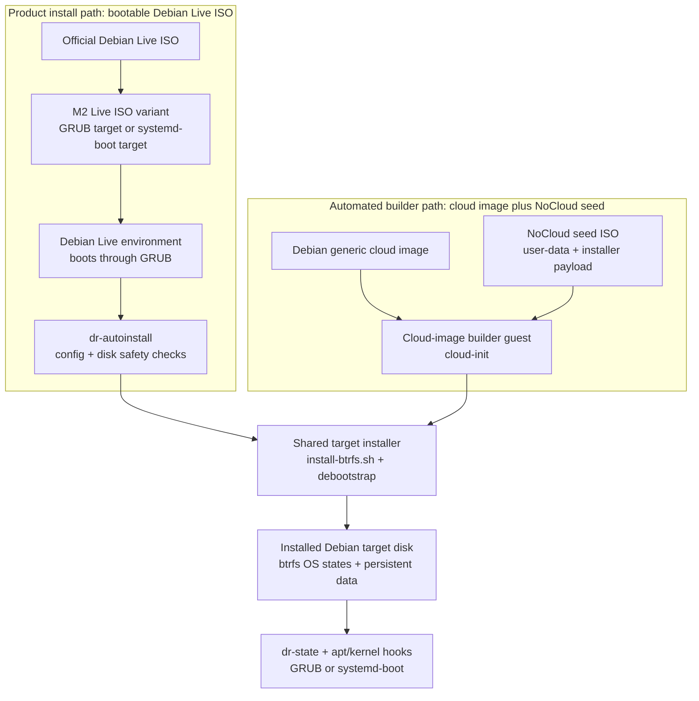

# Debian rollback: installation architecture

**Canonical architecture and current status, 2026-11-22.** This page describes
the media we build, the layers they contain, how they install a target, and
what Debian changes. Dated result reports remain the evidence record for the
particular source and guest they name.

## Current direction

- The product is a normal Debian installation managed with `apt`. It adds OS
  snapshots and bootable rollback states while keeping user and service data
  outside the OS-state rollback.
- btrfs is the current filesystem implementation. ZFS work is deferred until
  the systemd-boot path and its installer integration are complete.
- The merged M2 Debian Live installer installs GRUB on the target disk. The
  builder now produces separate GRUB-target and systemd-boot-target ISO
  variants from the same Debian Live base. Both Live environments continue to
  boot through Debian Live's GRUB menu; the build-time target choice is fixed
  in `/dr/target-bootloader` and passed to the shared target installer.
- New installations of either target variant start at
  `@os-000001-YYYYMMDD-HHMMSSZ-install`. Later states use a never-reused
  creation sequence, UTC timestamp, and origin/reason slug. The counter is
  stored at `/.top/.dr-state/last-sequence`, outside the OS-state subvolumes.
  This schema applies to fresh installs and new snapshots. Historical
  `@os-0001` PoC disks remain untouched and are not migrated; no adoption
  command is planned. The timestamped runtime is for fresh installs and must
  not be copied onto those old disks because its APT hook requires the new
  counter.
- Earlier v1001 guests proved builder installation, boot check, canonical ESP
  entries, rollback/default selection, and one-shot consumption on a disk built
  from `b94af9533`. Later transcripts record apt metadata and destructive
  recovery runs, but their injected source hashes are not represented by a Git
  revision. They are historical evidence, not certification of the candidate.
- Two kernel-upgrade guest attempts timed out after the scenario generated a
  shell command ending in `; ;`; a later guest run against the `c749db1`
  source passed 21 checks. Offline coverage now checks generated command
  syntax, and the integrated current candidate still needs a fresh guest run.
- The current systemd-boot backend and M2 target-bootloader variants are in
  this unmerged worktree. Fresh current-source systemd-boot and clean UEFI M2
  guest validation is pending.

## The layers

There are two ways to provision the same target-system design. They have
different boot environments and automation, but converge on the same target
installer and installed rollback runtime.



### Layer responsibilities

| Layer | What it does | Shared or path-specific |
|---|---|---|
| Debian input media | Supplies a Debian Live installer environment or a booted cloud-image builder guest | Path-specific |
| Installation media | Adds the M2 installer payload to Debian Live, or gives cloud-init its NoCloud instructions and PoC payload | Path-specific |
| Install configuration | Chooses target disk and install settings; M2 config can also set hostname, suite, mirrors, and credentials | M2 uses `dr-install.conf`; the builder uses cloud-init data |
| Disk planning and guards | Selects/validates a whole target disk and refuses ambiguous or unsafe targets | M2 runs `dr-plan`; the cloud PoC controls its disposable VM disks |
| Target installer | Partitions the target, installs Debian with `debootstrap`, creates btrfs subvolumes, and installs the requested bootloader | Shared: `poc/install-btrfs.sh` |
| Rollback runtime | Snapshots before package changes, refreshes boot entries, lists states, changes defaults, selects one-shot boots, and manages state retention | Shared `dr-state` and hooks; boot-entry writer is backend-specific |
| Installed target | Boots a chosen OS-state subvolume and mounts data subvolumes separately | Shared target layout; bootloader determines how kernels and entries are loaded |

The installer core is shared; the setup around it is not. The Live path uses
`dr-autoinstall` to make a guarded disk decision. The cloud-image PoC uses
cloud-init to automate a disposable builder guest. Neither the cloud image nor
the seed ISO is installed onto the final target disk.

## ISO and disk artifacts

An ISO is a generated artifact. Source scripts and the checksums of downloaded
inputs describe it; generated images belong in the resolved ISO artifact
directory, not in Git.

| Artifact | Boots by itself? | Role and contents | Status |
|---|---|---|---|
| Official Debian Live ISO | Yes | Upstream Live installer and GRUB boot path; read-only input to the M2 remaster | Input |
| M2 Debian rollback Live ISO, GRUB target | Yes | Debian Live plus `/dr` installer payload, live-config hook, and added GRUB entries; installs GRUB on the target | Implemented and merged |
| M2 Debian rollback Live ISO, systemd-boot target | Yes | Same Live install experience, with the build-time choice passed to the target installer | Builder implemented; fresh guest validation pending |
| NoCloud seed ISO | No; attach to the cloud-image guest | `user-data`, `meta-data`, installer scripts, and a `bootloader` marker | Implemented for GRUB and systemd-boot PoC builds |
| Debian generic cloud image | Yes | Boots the automated builder guest; it is not the rollback product image | PoC input |
| Installed target disk | Yes, after installation | UEFI ESP, btrfs OS state and separate persistent-data subvolumes, plus the selected target bootloader | GRUB covered by M2; systemd-boot under PoC validation |

The two planned M2 Live ISO variants differ in the **bootloader installed on
the target disk**. Both Live media continue to boot the Debian Live
environment through GRUB. The systemd-boot variant does not need a separate
systemd-boot live environment.

The bootloader selection belongs to the ISO build, not the install config.
`build-iso.sh` requires `--bootloader grub|systemd-boot` and writes the choice
to `/dr/target-bootloader`; `dr-autoinstall` validates the marker and passes it
to `install-btrfs.sh`. A `dr-install.conf` file or optional config medium
cannot change which target bootloader the selected ISO installs. The current
NoCloud builder is different: it uses a one-line
`bootloader` marker on the seed to select which backend to exercise.

## What changes from vanilla Debian

### On the M2 Live ISO

`iso/build-iso.sh` starts from the official Debian Live ISO and uses `xorriso`
to add or replace files in its ISO filesystem:

- `/dr/` contains `dr-autoinstall`, `dr-plan`, `dr-pick-disk`,
  `install-btrfs.sh`, `dr-state`, and optionally an embedded
  `dr-install.conf`; `/dr/target-bootloader` fixes the target bootloader for
  this ISO build.
- `/live/config-hooks/10-dr-autoinstall` starts the installer service in the
  Live environment when the selected GRUB entry includes `dr.mode=auto`.
- `/boot/grub/grub.cfg` gains an unattended-install entry and a Live entry
  that leaves the Live system available for manual use.

The Live squashfs and initrd are not rebuilt. Debian's Live userspace and
packages remain upstream. The base ISO's boot catalog is replayed; the added
GRUB menu is for UEFI, while the base BIOS menu is unchanged. This project
currently supports UEFI only. The M2 installer needs network access for
`debootstrap` and packages.

### On the installed target

`poc/install-btrfs.sh` wipes the selected whole target disk, creates a 512 MiB
EFI System Partition and a btrfs root partition, then uses Debian
`debootstrap` to create a fresh Debian system. The OS lives in a writable
subvolume such as `@os-000001-20261121-120000Z-install`. Separate subvolumes hold `/home`, `/root`, `/srv`,
`/var/www`, `/var/log`, `/var/lib/docker`, `/var/lib/containers`,
`/var/lib/postgresql`, `/var/lib/mysql`, and `/usr/local`; rolling back the OS
does not roll these paths back.

The installed system uses the normal Debian package manager. The project adds
`dr-state`, an APT `Pre-Install-Pkgs` hook that captures the package plan and
snapshots before dpkg changes files, a `Pre-Invoke` fallback with a dedupe
window, an apt post-invoke hook that refreshes boot entries, and kernel
post-install/post-remove hooks that refresh entries after kernel changes. This
is not an immutable OS or an alternate package manager.

State names use the same schema with either bootloader. The sequence is first,
so lexical order matches creation order even if the guest clock moves backward
or a state is deleted. The timestamp is UTC and readable at a glance. Examples:

```text
@os-000001-20261121-120000Z-install
@os-000002-20261121-121500Z-apt
@os-000003-20261121-123000Z-manual-before-driver
```

The first install receives sequence `000001`; a snapshot reserves the next
sequence before it is created. `/.top/.dr-state/last-sequence` is a durable
high-water mark. Deleting or pruning a state never decreases it, so gaps are
expected and IDs are never reused. If the counter is missing or malformed,
snapshot creation fails closed instead of guessing. It must remain outside the
OS-state subvolumes and must not be deleted as cleanup. This fresh-install
schema does not migrate historical `@os-0001` disks; their state names remain
as they were, and they must keep using their matching existing runtime. There
is no migration or counter-adoption command.

A manual snapshot can include a concise reason and an optional note, for
example:

```sh
dr-state snapshot --reason before-upgrade --note "Before testing graphics driver 2.4"
```

Each initialized install state and new snapshot has a report sidecar under
`/.top/.dr-state/metadata/`, outside the OS subvolumes. It records the sequence
and slug as well as the full reason, optional note, OS release, kernel, selected
package versions, and APT plan. `dr-state list` gives a compact inventory,
`dr-state list --long` expands every state, and `dr-state show STATE` reports
the captured UTC creation time, source, reason, note, parent state, OS release,
running kernel, selected core package versions, and any APT package actions.
APT snapshots automatically record their planned package changes. The sidecar
survives OS rollback but is not part of the boot recovery chain; supported
state deletion and pruning remove the matching sidecar.

The target bootloader changes how each OS state is made bootable:

- **GRUB:** the installer installs Debian's GRUB EFI package. GRUB reads a
  state's kernel from btrfs; `dr-state` generates menu entries and manages the
  persistent default and one-shot selection.
- **systemd-boot:** the installer installs `systemd-boot` and
  `systemd-boot-efi`, runs `bootctl install --no-variables`, and records the
  backend in `/etc/dr-state.conf` and an ESP marker. Since systemd-boot cannot
  read kernels from btrfs, `dr-state` copies each bootable state's kernel and
  initrd to the ESP and writes Boot Loader Specification entries. The apt and
  `zz-dr-state` kernel hooks are shared with GRUB. The installer diverts
  Debian's `/etc/kernel/postinst.d/zz-systemd-boot` and
  `/etc/kernel/postrm.d/zz-systemd-boot` scripts into
  `/etc/kernel/dr-disabled/`, outside both hook directories, so neither
  ordinary nor LSB-aware `run-parts` invokes them. The systemd-boot package
  post-install script also calls `kernel-install` directly, so the installer
  disables the stock `/usr/lib/kernel/install.d/90-loaderentry.install`
  writer with `/etc/kernel/install.d/90-loaderentry.install -> /dev/null`.
  `dr-state` is then the sole writer of per-state BLS entries.

## Installation and use flows

### Product installation: M2 Debian Live ISO

1. Build or obtain the chosen UEFI Live ISO variant and boot it on the machine
   that will receive Debian. The GRUB-target artifact is merged; the
   systemd-boot-target artifact is under fresh guest validation.
2. Choose the unattended-install menu entry, or boot the Live system entry for
   manual work. The unattended entry starts `dr-autoinstall` through
   `live-config`.
3. Optionally provide install settings from one source: an attached `CIDATA`
   medium containing `dr-install.conf`, a config embedded in the ISO, or the
   `dr.config=https://…` kernel parameter. If several are available, the
   installer checks them in this order: attached `CIDATA`, embedded file, URL.
4. `dr-autoinstall` asks `dr-plan` to choose or validate a whole target disk.
   With no config, it proceeds only when there is one qualifying internal
   disk and requires typed confirmation before wiping it. Ambiguous or unsafe
   selections are refused. It downloads Debian tools, plans again, and refuses
   if the target identity changed or the disk already contains a rollback
   system without an explicit reinstall setting.
5. The ISO's embedded target choice is validated and passed with the checked
   disk to `install-btrfs.sh`. The installer creates the timestamped initial
   state, writes its `000001` metadata and sequence counter, generates the
   selected boot menu, and powers off by default. Remove the Live media and
   boot the target.
6. Use Debian normally. Before package changes, the APT hook snapshots the
   running OS state and records the planned package operations. Before a
   manual change, create a snapshot with `--reason` and an optional `--note`.
   Use `dr-state list` to inventory states and `dr-state show STATE` for the
   captured OS, kernel, package, and note details. After manually booting a
   known-good older state, `set-default` makes it permanent and
   `delete STATE --yes` removes an unusable inactive OS state.
   `prune --keep N` removes excess older snapshots. User and service data
   stays in separate subvolumes.

The optional M2 `CIDATA` medium is a **configuration medium**, not a NoCloud
cloud-init seed. It supplies `dr-install.conf` directly to `dr-autoinstall`.
Without it, settings may come from the ISO, URL, or guarded console-confirm
path.

### Automated PoC installation: cloud image plus NoCloud seed

1. Boot a Debian generic cloud image as a builder guest with a blank target
   virtual disk attached.
2. Attach the NoCloud seed ISO. Cloud-init reads its `user-data` and
   `meta-data`; the user-data installs the build tools, mounts the seed, reads
   the `bootloader` marker, and runs `install-btrfs.sh` against the disposable
   target disk.
3. Shut down the builder guest. Boot the installed target disk on its own,
   then run guest scenarios for snapshots, rollback, defaults, kernel
   handling, and bootloader behavior.

The NoCloud seed ISO is required by this **automated builder recipe as
currently written**. Another way to provision the builder guest could replace
it. It is not the product installer ISO, is not installed on the target, and
is not needed by the M2 Live installation flow.

### Direct answer: is the NoCloud seed optional?

**Yes, it is optional for installing the product with the M2 Live ISO.** The
M2 installer can get its settings from an embedded file, an HTTPS URL, or the
guarded console-confirm path. An attached M2 `CIDATA` config medium is also
optional. The NoCloud seed is needed only by the current cloud-image PoC
automation, where cloud-init uses it to start the builder install.

## Code and evidence map

| Topic | Source or evidence |
|---|---|
| M2 ISO construction and config flow | `iso/build-iso.sh`, `iso/dr-autoinstall`, `iso/dr-plan`, `iso/build-cidata.sh` |
| Shared target installation and layout | `poc/install-btrfs.sh` |
| Snapshots, menus, boot-once, defaults, deletion, pruning | `poc/dr-state` |
| Recovery contract, destructive acceptance scenarios, and recovery boundary | [ROLLBACK-RECOVERY.md](ROLLBACK-RECOVERY.md) |
| Cloud-image NoCloud builder | `poc/build-seed.sh`, `poc/seed/user-data`, `poc/seed/meta-data` |
| M2 guest evidence and limits | [RESULTS-M2-UNATTENDED-ISO-2026-11-18.md](RESULTS-M2-UNATTENDED-ISO-2026-11-18.md) |
| systemd-boot implementation, guest findings, and offline coverage | [SDBOOT-VARIANT-2026-11-18.md](SDBOOT-VARIANT-2026-11-18.md) |
| Product decisions and rationale | [DESIGN-GUIDE.md](DESIGN-GUIDE.md) |
| Current work order | [`../TODO.md`](../TODO.md) |

Update this page when media contents, bootloader selection, config precedence,
target layout, or install flow changes. Keep dated reports tied to the exact
build and guest evidence they record.
