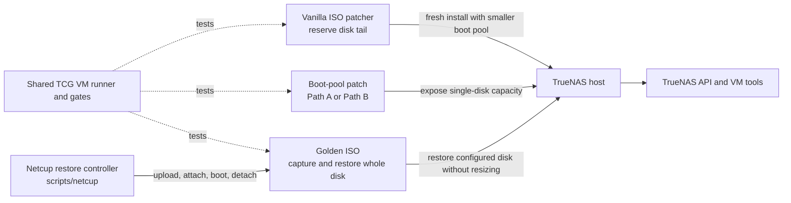

# TrueNAS storage and deployment work

For the boot-disk storage patch's supported builds, Path A/Path B behavior,
update and rollback workflow, and current acceptance status, see the
[patch overview](docs/OVERVIEW.md). Its exact-build policy and adoption steps
link to the [design guide](boot-pool-patch/docs/DESIGN-GUIDE.md#support-policy-and-update-state)
and [consumer workflow](boot-pool-patch/docs/CONSUMERS.md#update-and-reapply-workflow).

## Why use the system disk

TrueNAS installs its operating system in `boot-pool` and normally expects
workloads to use a separate data pool. Small servers and cloud VMs may have
only one local disk. This work explores using space on that system disk for
VM definitions and virtual disks, container images and volumes, and user data
and shares, while keeping TrueNAS boot environments and internal datasets
protected.

A related use case already has a data pool on another disk and wants a cache
device for it. The intended layout is to store a zvol on the system disk using
Path A or Path B, then attach that zvol as an L2ARC read-cache vdev to the
separate data pool. OpenZFS defines zvols as block devices and L2ARC as an
optional read cache ([zvol guide](https://openzfs.github.io/openzfs-docs/Basic%20Concepts/Datasets/ZVOLs.html),
[caching guide](https://openzfs.github.io/openzfs-docs/Basic%20Concepts/Pool%20Structure/Caching.html));
this layout is plausible at the ZFS layer, but it has not yet been tested with
a real second-disk data pool. L2ARC does not add usable filesystem capacity or
protect the data pool from disk failure.

The scope now includes L2ARC cache, SLOG/log, and special metadata vdevs for a
separate data pool, including sparse single-disk and RAIDZ1 targets. The
registered v27 Path A API/UI diagnostic created seven 128 MiB zvols through
the UI and both target pool shapes. The pool wizard displayed Cache, Log, and
Special steps but omitted the boot-pool zvols. Middleware refused the
`pool.update` requests for their `/dev/zvol/...` paths with `[EINVAL] ... disks
were not found in system`, before ZFS attachment. Direct checks showed both
targets ONLINE with empty auxiliary-role arrays, and cleanup passed. This is
safe-refusal evidence, not role acceptance. Same-device reuse, role-by-role
API calls, partitions, Path B, a separate source pool, and real SLOG or
metadata-allocation behavior remain open. A zvol can back a different pool
while its source pool is imported; using a pool's own zvol as one of its vdevs
would create a dependency cycle. Multiple zvols or partitions on one disk
remain in one physical failure domain. Special vdevs contain critical pool
data and must be at least as redundant as the data vdev; L2ARC is optional read
cache and SLOG serves synchronous-write durability. Sparse VM disks were enough
to create and inspect the disposable pools, but do not test performance,
endurance, power-loss behavior, or physical fault tolerance. See the
[design guide](boot-pool-patch/docs/DESIGN-GUIDE.md#auxiliary-vdevs-on-boot-disk-storage)
and [consumer guide](boot-pool-patch/docs/CONSUMERS.md#test-auxiliary-vdev-roles)
for evidence and the next test boundary.

There are two experimental ways to expose space on the system disk:

| Path | Layout | When it fits | Main tradeoff |
|---|---|---|---|
| **A: `boot-pool/user-data`** | Keep the partition table and boot pool; expose a bounded, mounted user-data tree inside `boot-pool`. | A full-disk install with no free partition tail. | User data shares the ZFS pool with the operating system and needs release-specific middleware, mount, and UI safeguards. |
| **B: `boot-disk-data`** | Keep the boot-pool partition unchanged; create a new partition and ZFS pool in a free tail after it. | Reserve the tail before install with the vanilla ISO patcher or another bounded installation image. A stock full-disk install has no tail to use. | User data gets a separate ZFS pool, but needs partition-aware provisioning. Both pools still share the same physical disk. |

Both paths keep the existing boot-pool partition size. They use the same
physical system disk, so Path B provides a separate ZFS pool but does not add
disk-failure redundancy.

Both paths are intended to support user datasets and shares, VM definitions
and virtual disks, and container images, writable layers, and persistent
datasets. Where KVM or nested virtualization is unavailable, a separate patch
allows TrueNAS to run VMs through QEMU TCG software emulation. This is slower
than hardware virtualization. On v27 Path A, create the bounded
`boot-pool/user-data` root in the Datasets UI and set **Quota for this dataset
and all children**. That field sets the finite `quota` required by the guard;
the nearby dataset-only field sets `refquota`. The patch pins the required
mountpoint and mount policy. The previous apparent quota submission defect
was the UI test filling the dataset-only `refquota` field. The corrected
PWMCP interaction captures the actual RPC payload and verifies the finite
`quota`. The v27 Oct 27 nightly passed the full Path A/B API/UI matrix. The
newer v27 bridge build `27.0.0-MASTER+20261029-173417` has exact-source and
Path A update/reapply survival, adapter, and API checks; its latest UI lane
correctly refused the survival fixture's existing VM record before changing
the UI. A clean-target UI acceptance remains open. The Path B
`ui-wizard` route reserves the free-tail partition with the guarded
partition-only lane, then TrueNAS creates `boot-disk-data` from that partition.
The earlier diagnostic where `disk.query` omitted `/dev/vda4` is historical;
the current shim supplies the eligible reserved partition to the wizard. The separate
`preprovisioned` mode tests downstream UI forms after the guarded provisioner
creates/registers the pool; its registered unit gate passed on 2026-10-21
with 170 tests and 45 subtests, but that separate mode has not had a fresh live
run and rejects any browser `pool.create` request. See the [boot-pool patch
design guide](boot-pool-patch/docs/DESIGN-GUIDE.md#pwmcp-storage-ui-acceptance)
and [UI consumer steps](boot-pool-patch/docs/CONSUMERS.md#run-pwmcp-ui-storage-acceptance).

For this cache use case, the durable data stays on the other disk; the
system-disk zvol is only an optional cache device. Scripted `zpool` checks
added, inspected, and removed a zvol cache vdev against a temporary
file-backed target pool on v27 Path A and B and v28 Path A. The v28 Path B
run also passed that cache check and TCG VM startup, then exposed a destroy
guard failure. A later registered regression gate directly verified that the
existing container-managed dataset survived both destroy and snapshot
attempts, and that no attempted snapshot appeared. The original failure log
remains preserved. No test has used a real second disk as the target pool.
TrueNAS UI or middleware cache controls, reboot/import ordering, and
representative performance also remain untested. See the patch
[design guide](boot-pool-patch/docs/DESIGN-GUIDE.md#cache-vdevs) and
[handoff checklist](boot-pool-patch/HANDOFF.md) for evidence and open checks.

On TrueNAS 27.0.0-RC.1, the live UI showed Session Timeout under the signed-in
account menu → **Preferences**. The field was visible and set to 300 seconds.
It is a per-user idle timeout; activity resets it. The official Preferences
guide documents a 300-second default and maximum of 2,147,482 seconds; the
Advanced Settings guide also describes **System → Advanced Settings → Access
→ Configure**. The direct UI check confirms the Preferences route on this
build, so there is no need to inventory this setting as missing from the UI.
See the official [Preferences guide](https://www.truenas.com/docs/scale/27/toptoolbar/settings/)
and [Advanced Settings guide](https://www.truenas.com/docs/scale/27/systemsettings/advanced/advancedsettings/).

The current exact-build registry contains v27 RC.1, the single v27
pre-RC.2 bridge nightly `27.0.0-MASTER+20261029-173417`, and only the latest
v28 rolling nightly `28.0.0-MASTER+20261029-175210`. The earlier v27 Oct 27
build passed the full Path A/B API/UI matrix; this does not certify the Oct 29
adapter's UI. The generated
[acceptance index](docs/ACCEPTANCE-RESULTS.md) separates survival, API, UI,
and adapter results by source state and target build. The updater creates a
new stock `/usr`, copies a stale v27 record into the new BE's `/root`, leaves
Path A data unmounted until reapply, and preserves Path B pool identity/data.
The v27 fresh-install action refuses a pre-existing Path B pool; the runner
uses the digest-bound `reapply-after-update` route. See the patch
[design guide](boot-pool-patch/docs/DESIGN-GUIDE.md#support-policy-and-update-state)
and [consumer update workflow](boot-pool-patch/docs/CONSUMERS.md#update-and-reapply-workflow)
for the lifecycle and commands.

The patch remains experimental. The disposable acceptance host has no `/dev/kvm`, so VM API acceptance
verified a QEMU TCG process start but did not boot a guest OS or exercise actual
KVM selection. SMB/NFS UI and record workflows passed, but a share client could
not connect from the devcontainer. The available Netcup controller exposes
disk inspection without a disk-attach operation, so no second disk was added
or purchased; a real second-disk cache target and UI/middleware cache setup
remain open. Retention of pre-existing user workloads through update also
needs a direct content/record comparison. See the [patch handoff](boot-pool-patch/HANDOFF.md)
for the remaining acceptance boundaries.

## Workstreams

- [Boot-pool patch](boot-pool-patch/README.md) adapts TrueNAS middleware and
  UI behavior to expose the selected Path A or Path B storage safely. It also
  explores TCG VM support when KVM is unavailable. See its [design guide](boot-pool-patch/docs/DESIGN-GUIDE.md)
  and [consumer guide](boot-pool-patch/docs/CONSUMERS.md).
- [Golden ISO](golden-iso/README.md) configures a source installation, captures
  its whole disk with a sibling secret TOML, and builds an unattended restore
  ISO. Restore keeps the captured partition sizes. Patch application is a
  separate step. See its [design guide](golden-iso/docs/DESIGN-GUIDE.md) and
  [consumer guide](golden-iso/docs/CONSUMERS.md).
- [Vanilla ISO patcher](vanilla-iso-patcher/README.md) edits a stock TrueNAS
  installer to cap partition 3 and leave a free tail for Path B. It does not
  create a data partition or pool. See its [consumer procedure](vanilla-iso-patcher/CONSUMERS.md)
  and the shared [bounded-install notes](docs/CONSUMERS.md#reserve-boot-pool-size-during-install).
- The shared [API client](truenas_api_client.py), [API CLI](truenas-api.py),
  and [VM CLI](install-vm.py) provide generic TrueNAS API and VM lifecycle
  operations. They do not apply the boot-pool patch or control Netcup boot
  workflows.
- [`tcg_vm.py`](tcg_vm.py) and [`run-gate.py`](run-gate.py) provide local VM
  testing and registered gates. It can run up to three disposable TrueNAS guests
  in the host background slice when recent cgroup memory PSI is below policy.
  `--data-disk-size` adds sparse QCOW2 disks for isolated storage-topology
  tests and pins their PCI addresses above the base boot disk. See the [guest consumer guide](docs/CONSUMERS.md#run-a-local-truenas-tcg-guest)
  and [runner design](docs/DESIGN-GUIDE.md#sparse-additional-data-disks).
  The full-pressure threshold defaults to 1% and has an explicit per-start
  override documented in the [consumer guide](docs/CONSUMERS.md#run-a-local-truenas-tcg-guest).
  Gates run separately in the gates slice. QEMU is headless by default.
  `--vnc-console` and `--serial-console` are Unix socket only options, and
  `tcg_vm.py console serial` provides bidirectional serial access. The runner
  preserves stopped guest disk state. Its `rebind-media` command safely moves
  a stopped guest's identical ISO binding to a canonical path. Rebind every
  retained manifest before removing an old hard-link alias; the procedure
  preserves the guest overlay and EFI state. Read the shared
  [consumer guide](docs/CONSUMERS.md#rebind-an-iso-path-while-preserving-guest-state) and
  [runner design](docs/DESIGN-GUIDE.md#isolated-local-qemu-guests). For local
  guest setup and admission behavior, see the [TCG guest guide](docs/CONSUMERS.md#run-a-local-truenas-tcg-guest).
  After a host restart, resume allows only an OVMF source device-number change
  when its path and full file identity still match; see the [runner rationale](docs/DESIGN-GUIDE.md#isolated-local-qemu-guests).
- The networked live-gate runner can recover a tester left exited by an
  interrupted run through its explicit `--recover-stale-tester` option. It
  verifies the image, ownership label, and stopped state before removing the
  exact container ID. Remote SSH retries are bounded to known pre-command
  transport failures; command failures are not replayed. See the patch [design rationale](boot-pool-patch/docs/DESIGN-GUIDE.md#recover-an-interrupted-live-tester)
  and [consumer command](boot-pool-patch/docs/CONSUMERS.md#recover-an-interrupted-live-tester).
- For an interrupted Path A UI run that already created a test dataset, the
  registered `live-ui` resume accepts only its exact generated path through
  `TRUENAS_TEST_RESUME_EXISTING_UI_DATASET`; it checks the filesystem and its
  two zvols and rejects other descendants. See the patch [design rationale](boot-pool-patch/docs/DESIGN-GUIDE.md#pwmcp-storage-ui-acceptance)
  and [consumer procedure](boot-pool-patch/docs/CONSUMERS.md#resume-a-partial-path-a-ui-run).
- The Netcup [`install-restore-iso.py`](../netcup/install-restore-iso.py)
  controller owns provider-side ISO upload, attachment, boot order, and power
  operations. Guest-side eject does not detach Netcup virtual media.

The vanilla ISO patcher can reserve the tail needed by Path B during a fresh
install. The golden-image workflow instead restores a previously configured
system disk without resizing its ZFS partition; Path A can use existing
boot-pool space, while Path B needs a tail that was reserved before capture.
The patch can be applied after restore, or manually before capturing the
golden image. The API tools can inspect or operate the resulting host.

All release evidence is scoped to the exact ISO or middleware fingerprints
named in each subproject. Check each subproject's current status and open
acceptance items before treating a workflow as ready for broader use.
